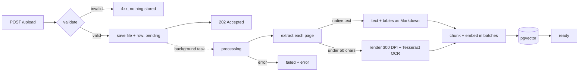

# AI Business Analyst Copilot

Ask questions about your PDFs and get answers grounded in them, with the document name and page for every source.

Built with FastAPI, PostgreSQL + pgvector, Sentence Transformers, Tesseract OCR and Groq.

## Features

* PDF upload with validation (signature, size, page count, password protection)
* Background ingestion with a status you can poll
* Page-by-page text extraction, with per-page error isolation
* Tables detected and stored as Markdown, one chunk per table with its heading
* OCR for scanned pages, with a confidence score stored per chunk
* Vector search with an HNSW index (cosine distance)
* Retrieval-Augmented Generation (RAG) with real sources: document, page and OCR confidence

## How it works



**Ingestion** runs in a FastAPI background task after `/upload` responds:

1. **Validate** (synchronous, cheapest checks first): not empty, at most `MAX_UPLOAD_MB`, `%PDF-` signature in the first 1 KB, parses as a PDF, no user password, 1 to `MAX_PDF_PAGES` pages. Rejected files are never saved and get no database row.
2. **Extract each page** in its own `try/except`:
   * **Native text:** tables are found with `find_tables()` and converted to Markdown. The text outside the tables becomes prose.
   * **Scanned page** (fewer than 50 native characters): rendered at 300 DPI and read with Tesseract. The page's confidence (0-100, weighted by word length) is stored with its chunks.
   * A broken page is skipped and the rest of the document is kept. Environment errors (such as Tesseract missing) fail the whole document instead.
3. **Chunk:** prose is split per page (1000 characters, 200 overlap), so every chunk has exactly one page. Each table is a single chunk, prefixed with its nearest heading and caption.
4. **Embed** all chunks in one batched call (`BAAI/bge-small-en-v1.5`, 384 dimensions) and store them. Chunks and the `ready` status commit in one transaction, so a failure never leaves partial chunks behind.

**Asking:** the question is embedded, the 5 nearest chunks from `ready` documents are retrieved, and the LLM answers using only that context. Sources come from the database, not from the LLM's text.

### Document status

```
pending ──> processing ──> ready
                 └──────> failed
```

| Status | Meaning |
|---|---|
| `pending` | Uploaded, waiting for the background task |
| `processing` | Extracting, chunking and embedding |
| `ready` | Searchable. `error` may hold a warning, e.g. `Skipped pages 4, 7` |
| `failed` | `error` says why. Nothing from this document is searchable |

Background tasks live in memory. If the server restarts mid-ingestion, the document is marked `failed` ("Interrupted by server restart") on startup. Upload it again.

## Tech stack

* **API:** FastAPI, Uvicorn
* **Database:** PostgreSQL 17 + pgvector (HNSW index, `vector_cosine_ops`), SQLAlchemy, Alembic
* **PDF:** PyMuPDF (text, tables, rendering), Tesseract via pytesseract (OCR)
* **Chunking:** LangChain `RecursiveCharacterTextSplitter`
* **Embeddings:** Sentence Transformers, `BAAI/bge-small-en-v1.5`
* **LLM:** Groq (default `openai/gpt-oss-120b`)
* **Infrastructure:** Docker Compose (Postgres, and Redis reserved for a future job queue)

## Setup

### Prerequisites

* Python 3.13
* Docker
* [Tesseract OCR](https://github.com/UB-Mannheim/tesseract/wiki) (Windows installer), or `apt install tesseract-ocr` / `brew install tesseract`
* A [Groq API key](https://console.groq.com/keys)

### Install

```bash
git clone <repo-url>
cd ai-business-analyst-copilot

python -m venv venv
venv\Scripts\activate          # Windows
# source venv/bin/activate     # macOS / Linux

pip install -r requirements.txt

cp .env.example .env           # then fill in GROQ_API_KEY

docker compose up -d
alembic upgrade head
```

### Configuration (`.env`)

| Variable | Default | Description |
|---|---|---|
| `DATABASE_URL` | none (required) | PostgreSQL connection string |
| `GROQ_API_KEY` | none (required) | Groq API key |
| `GROQ_MODEL` | `openai/gpt-oss-120b` | Groq chat model. List available ones with `GET https://api.groq.com/openai/v1/models` |
| `TESSERACT_CMD` | `tesseract` on PATH | Full path to the Tesseract binary (needed on Windows) |
| `MAX_UPLOAD_MB` | `25` | Maximum upload size |
| `MAX_PDF_PAGES` | `500` | Maximum pages per PDF |

### Run

```bash
uvicorn app.main:app --reload
```

The first start takes a while, because the embedding model downloads and loads. Interactive API docs are at http://127.0.0.1:8000/docs.

## API

| Method | Path | Description |
|---|---|---|
| `POST` | `/upload` | Upload a PDF (multipart field `file`). Returns `202` with `document_id` and `status_url` |
| `GET` | `/documents/{id}/status` | Lightweight status for polling: `status`, `error`, `chunks` |
| `GET` | `/documents` | All documents |
| `GET` | `/documents/{id}` | One document, including its extracted text |
| `POST` | `/search` | `{"query": "..."}`: 5 nearest chunks with document, page and OCR confidence |
| `POST` | `/ask` | `{"question": "..."}`: grounded answer plus sources |

### Upload errors

| Code | Cause |
|---|---|
| `413` | File larger than `MAX_UPLOAD_MB` |
| `415` | Not a PDF (missing `%PDF-` signature) |
| `422` | Empty, corrupt, password protected, no pages, or too many pages |

A file that passes validation but fails during processing still returns `202`, then shows `failed` on its status endpoint.

### Example

```bash
curl -F "file=@report.pdf" http://127.0.0.1:8000/upload
# {"document_id": 7, "status": "pending", "status_url": "/documents/7/status", ...}

curl http://127.0.0.1:8000/documents/7/status
# {"document_id": 7, "status": "ready", "error": null, "chunks": 42, ...}

curl -X POST http://127.0.0.1:8000/ask \
  -H "Content-Type: application/json" \
  -d '{"question": "What was revenue in Q3?"}'
```

```json
{
  "status": true,
  "question": "What was revenue in Q3?",
  "answer": {
    "answer": "Q3 revenue was $4.2M ...",
    "sources": [
      {"document_id": 7, "file_name": "report.pdf", "page": 12, "ocr_confidence": null}
    ]
  }
}
```

`ocr_confidence` is `null` for native PDF text and 0-100 for OCR'd pages. In `/search` results, `similarity` is the **cosine distance**: lower means more similar.

> **Windows tip:** use `127.0.0.1`, not `localhost`. `localhost` tries IPv6 first, and every request waits about 2 seconds before falling back.

## Testing it manually

1. Open http://127.0.0.1:8000/docs.
2. `POST /upload` a PDF, and note the `document_id`.
3. Poll `GET /documents/{id}/status` until it shows `ready`.
4. `POST /ask` with a question the PDF answers, and check that `sources` points to the right pages.
5. Try the failure paths: a `.txt` renamed to `.pdf` (415), a password-protected PDF (422), a blank PDF (`failed`).

## Project structure

```
app/
  main.py                   App, routers, startup recovery of interrupted jobs
  api/                      Routes: upload, documents, search, ask
  services/
    validation_service.py   Upload checks (size, signature, password, pages)
    pdf_service.py          Page extraction, tables, OCR
    chunk_service.py        Prose and table chunking
    embedding_service.py    Sentence Transformers (single and batched)
    document_service.py     Ingestion pipeline, status changes, background entry point
    search_service.py       pgvector similarity search
    rag_service.py          Prompt building, sources
    llm_service.py          Groq client
  database/                 SQLAlchemy models and session
alembic/versions/           Schema migrations
```

## Known limitations

* **Ingestion jobs are lost on restart.** Background tasks run in memory, with no retries. A queue (Celery, RQ or arq on the Redis already in compose) would make them durable.
* **Startup recovery assumes a single server process.** With `--workers N`, a restarting worker would mark another worker's in-flight jobs as `failed`.
* **Filenames are used as-is.** Re-uploading a name overwrites the stored file, and names aren't sanitized. Storing files under a UUID would fix both.
* **Duplicates are possible.** Uploading the same file twice creates two documents.
* **Tables:** headings are picked by position, so a table the typesetter moved elsewhere (a "float") can get the wrong heading. Very large tables are truncated in the embedding (512 tokens), though the LLM still sees all of them. Tables on scanned pages come out as plain text.
* **OCR is English only** and takes about 1-3 seconds per page on CPU.
* **The size limit is enforced after upload.** Put a reverse proxy limit in front of the app too, e.g. nginx `client_max_body_size`.
